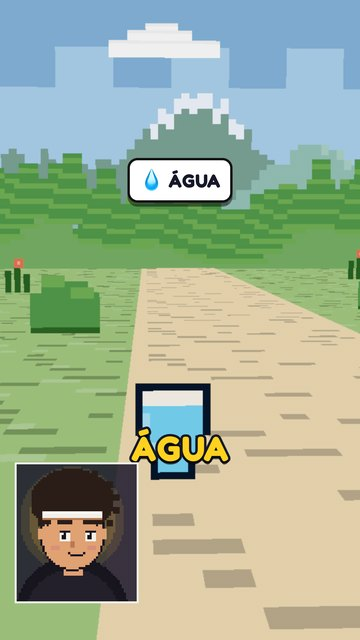

# Motor Animado · Painel

Da frase ao vídeo vertical animado, numa página que abre no seu navegador.

Você escreve a ideia em uma frase. Um agente de IA pesquisa, confere os fatos, escreve o roteiro e sugere o estilo.
Você escolhe a aparência e personaliza numa prévia. O painel grava a voz, monta as cenas, renderiza, mixa e confere o
resultado. Tudo acontece neste computador: nada é enviado para um serviço de vídeo.



## O que você precisa

| | |
|---|---|
| **Computador** | Mac com chip Apple (M1 ou mais novo) |
| **Programas** | Homebrew, Node 18+, Python 3.11+, ffmpeg-full, yt-dlp (o instalador confere e diz o que falta) |
| **Agente de IA** | pelo menos um: Claude Code, Codex (ChatGPT) ou Gemini CLI, com a conta já conectada |
| **Opcional** | conta da ElevenLabs, para a voz profissional (as vozes grátis já vêm configuradas) |

## Instalar

```bash
bash instalar.sh
```

O passo a passo com explicações está em [INSTALACAO.md](INSTALACAO.md).

## Abrir o painel

```bash
node painel/servidor.mjs
```

Depois abra **http://127.0.0.1:4747** no navegador. No Mac, dá para abrir com dois cliques em `abrir-painel.command`.

## Os cinco passos

1. **Ideia** — uma frase, o objetivo, a duração, para quem é o roteiro (leigo, ou estudantes e profissionais de saúde)
   e a especialidade (geral, neurologia, neurocirurgia, neurovascular, cardiologia ou ortopedia). O público muda a
   linguagem, a profundidade e as regras de cuidado; a especialidade diz ao agente que guia de anatomia e fisiologia
   seguir e como o médico raciocina naquele tema.
2. **Roteiro** — o agente pesquisa, confere cada número em duas fontes, escreve o roteiro e as fontes, e sugere três
   estilos. Você edita o texto na tela e vê os avisos do que precisa da sua revisão.
3. **Estilo** — galeria de estilos com prévia, tema de cores, apresentador, legenda e música. Dá para criar temas novos
   ou importar um tema de um arquivo ou de uma imagem de referência.
4. **Cenas** — o painel grava uma voz de teste, monta a cena, o agente escreve a animação e o painel desenha o mapa de
   cenas; o agente revisa e corrige o que ficou cortado ou tampado. Você pede ajustes em português.
5. **Voz e render** — voz do Mac, Chatterbox (grátis, gerada aqui) ou ElevenLabs (paga, com o custo na tela); rascunho
   ou render final; conferência automática de cortes, quadros pretos, pisca e volume; o vídeo toca na própria página.

## Os projetos já feitos

O botão **Projetos**, no topo, mostra todos os vídeos feitos no painel, cada um num cartão com capa, etapa, público,
especialidade, vídeos e espaço no disco. Dali dá para **abrir**, **gerar novamente** (um projeto novo com a mesma
ideia e as mesmas escolhas; o original fica como está), **duplicar** (copia o trabalho sem os vídeos renderizados) ou
**excluir** (a pasta vai para `videos/_lixeira`, de onde dá para recuperar).

## O que vem na caixa

| Pasta | O que é |
|---|---|
| `painel/` | o painel: servidor, telas e a ligação com os agentes de IA |
| `motor-animado/` | o motor que desenha e renderiza os vídeos, com 24 estilos prontos, as peças de exame em pixel e as ferramentas de voz, som e conferência |
| `videos/` | onde cada projeto que você fizer é guardado |

Para o pacote não pesar centenas de megabytes, os **vídeos de referência** usados no estudo dos estilos não vêm junto:
a análise escrita deles está em `motor-animado/decupagem/<nome>/decupagem.md`, e o material pesado é baixado neste
computador quando você quiser, com `bash baixar-extras.sh` (o instalador oferece na primeira vez). Nada disso é
necessário para fazer vídeos: os estilos já vêm prontos.

## Outros motores de animação

O painel também sabe pedir o vídeo a motores feitos por outras pessoas: **Anidoodle**, **animação em canvas**,
**Manim** e **Huashu Art Motion**. Eles não vêm no pacote (cada um tem a licença do seu autor); você instala o que
quiser e o painel passa a mostrá-los no passo Estilo, com o roteiro e a voz já prontos. Os comandos de instalação
estão em [INSTALACAO.md](INSTALACAO.md), no passo 4b.

## Avisos importantes

- **Conteúdo de saúde**: o painel pede duas fontes para cada número e marca o que ficou sem confirmação, mas **a revisão
  humana continua sendo sua**. Nada substitui a leitura de um profissional antes de publicar.
- **Custo**: o agente de IA usa a cota da conta dele (Claude, ChatGPT ou Google). A voz da ElevenLabs é paga e o painel
  sempre mostra o custo e espera o seu clique.
- **Chaves**: a chave da ElevenLabs fica só no arquivo `videos/.env` deste computador, nunca na tela nem no pacote.
- **Antes de repassar este pacote**, leia [CREDITOS.md](CREDITOS.md): parte do motor nasceu do estudo de skills de
  outras pessoas, e a redistribuição depende da autorização delas.

## Problemas comuns

| O que aparece | O que fazer |
|---|---|
| "o agente não está instalado" | instale o agente que você escolheu em Ajustes (o comando aparece na própria tela) |
| "falta instalar: brew install ..." | rode o comando que o instalador mostrou e tente de novo |
| a porta 4747 está ocupada | `PORTA=5000 node painel/servidor.mjs` e abra http://127.0.0.1:5000 |
| o render parou no meio | rode de novo: o painel reaproveita os quadros já desenhados |
| o limite da conta de IA acabou | o painel avisa e guarda o que já foi escrito; continue quando a cota voltar |

Detalhes de cada parte: [painel/README.md](painel/README.md) e [motor-animado/SKILL.md](motor-animado/SKILL.md).

---

Feito por **Felipe Ribeiro** — github.com/felipedaneuro · @felipedaneuro.
Licença MIT para o código próprio (ver `LICENSE`); créditos de terceiros e condições de redistribuição em
[CREDITOS.md](CREDITOS.md).
